# Flow Aplikasi — Network Device Mapping & Monitoring (v2)

Stack: **PostgreSQL + PostGIS**, **Bun + Hono** (API), **React + Leaflet (ESRI satellite)**, **Drizzle ORM**. Deploy via **Docker Compose**, dev langsung pakai **Bun**, konfigurasi lewat **.env**, tanpa reverse proxy, tanpa CI/CD.

Perubahan dari versi sebelumnya:

- Layout UI disamakan dengan tldraw: logo kiri atas, notifikasi kanan atas, toolbar tengah bawah.
- Akun/logout/katalog dipindah ke menu titik tiga di samping logo.
- Ditambah flow notifikasi perubahan status.
- ERD ditambah `TAGS`, `DEVICE_TAGS`, `NOTIFICATIONS`, dan kolom `next_check_at`.
- Penomoran section dirapikan berurutan.

---

## 1. Arsitektur Sistem

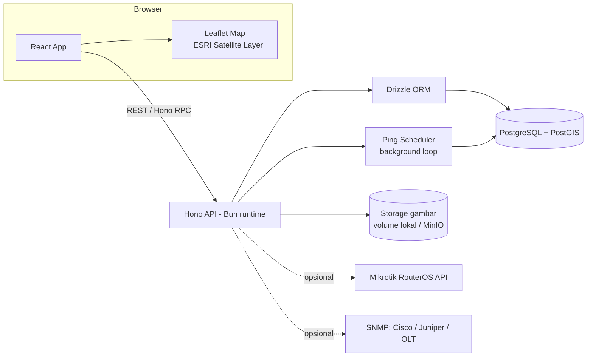

---

## 2. Entity Relationship Diagram (ERD)

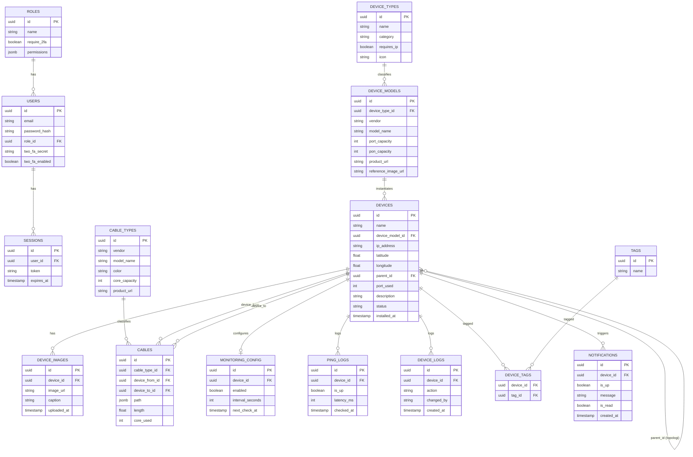

---

## 3. Layout UI — Map Full-Screen dengan Overlay Mengambang (ala tldraw)

Map jadi base layer penuh layar. Semua kontrol adalah panel mengambang di atasnya, bukan bagian dari flex layout biasa.

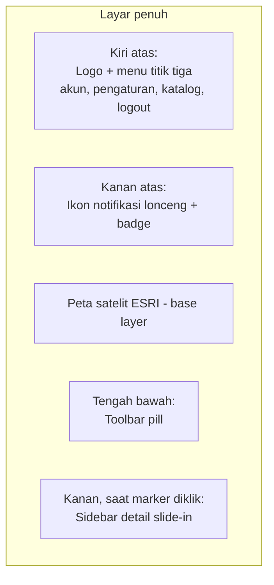

Susunan visual:

```
┌──────────────────────────────────────────────┐
│ [Logo] ⋮                                🔔   │
│                                              │
│                                              │
│              (peta satelit penuh)            │
│                                              │
│                                              │
│     ┌────────────────────────────────────┐   │
│     │ ↖  ✋  + Perangkat  + Kabel  🔍  ◎  ⌃ │   │
│     └────────────────────────────────────┘   │
└──────────────────────────────────────────────┘
```

**Toolbar tengah bawah** (satu tool aktif pada satu waktu, ditandai kotak biru):

| Tool | Fungsi |
|---|---|
| Select | Pilih marker/kabel, buka sidebar |
| Pan | Geser peta |
| + Perangkat | Mode tambah perangkat (flow #6) |
| + Kabel | Mode gambar kabel (flow #7) |
| Search | Buka search box (flow #10) |
| Clustering | Toggle cluster marker (flow #10) |
| ⌃ More | Filter Type / Tag aktif |

**Menu titik tiga (kiri atas):** Katalog Perangkat, Katalog Kabel, Pengaturan, Akun, Logout. Kelola User/Role hanya tampil untuk role dengan permission terkait.

**Gaya visual:** panel putih, `border-radius` ±12px, bayangan lembut, ikon outline tipis (lucide-react) ukuran 20px, tombol 40×40px, satu warna aksen biru, font Inter.

**Struktur komponen:**

```tsx
<div className="app-root">        {/* relative, 100vw/100vh, overflow hidden */}
  <MapView />                      {/* absolute inset-0, z-0 */}
  <div className="overlay">        {/* absolute inset-0, pointer-events: none, z-10 */}
    <TopLeft />                    {/* panel: Logo + MainMenu */}
    <TopRight />                   {/* panel: NotificationBell */}
    <BottomCenter />               {/* panel: Toolbar */}
  </div>
  <DeviceSidebar />                {/* absolute right-0, slide-in, z-20 */}
</div>
```

Catatan penting: container overlay pembungkus penuh layar wajib `pointer-events: none` supaya klik/drag map di baliknya tidak terblokir; tiap panel di dalamnya memakai `pointer-events: auto`. Kontrol bawaan Leaflet (zoom +/-) dinonaktifkan atau dipindah; atribusi ESRI tetap ditampilkan kecil di kanan bawah.

---

## 4. Flow Login & 2FA (configurable per role)

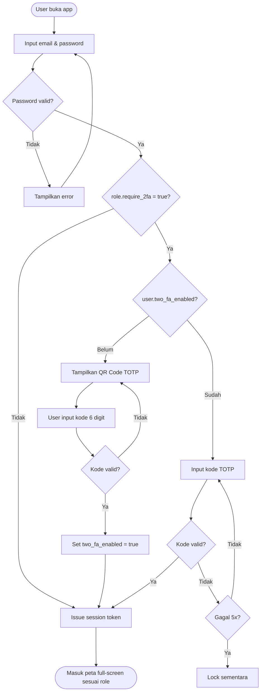

---

## 5. Flow Katalog Perangkat (Device Type → Device Model) & Cable Type

Katalog dibangun **sekali**, lalu dipakai berkali-kali saat menempatkan perangkat di peta — bukan input ulang spek tiap lokasi. Diakses dari menu titik tiga di kiri atas.

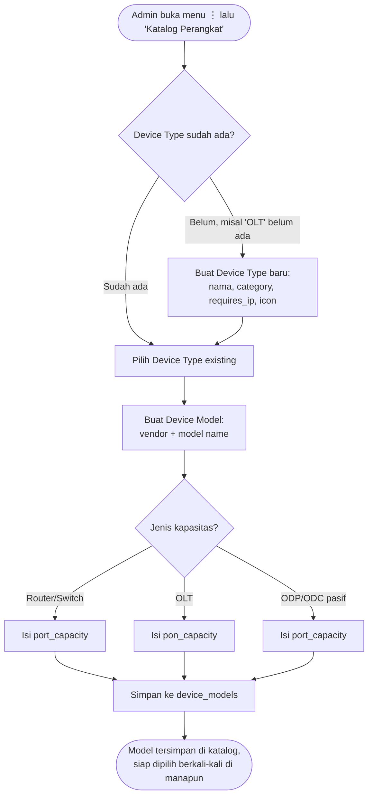

Contoh: buat Device Type **Router** → Device Model **Mikrotik CCR2116-12G-4S+** (port capacity diisi); buat Device Type baru **OLT** → Device Model **ZTE C320** (PON capacity diisi); buat Device Type **ODP**/**ODC** → model-model pasif dengan port capacity masing-masing.

**Cable Types mengikuti pola yang sama** (katalog, bukan per-instance):

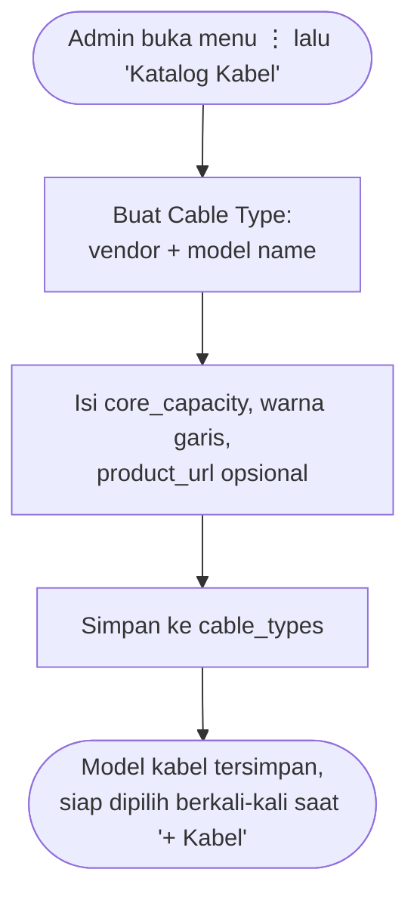

Contoh: buat Cable Type **Furukawa Fiber Optic 24 Core Single-mode ADSS** sekali → setiap kali menggambar kabel fisik di peta, tinggal pilih model ini dari katalog.

---

## 6. Flow Tambah Perangkat di Map (pakai katalog, cepat & berulang)

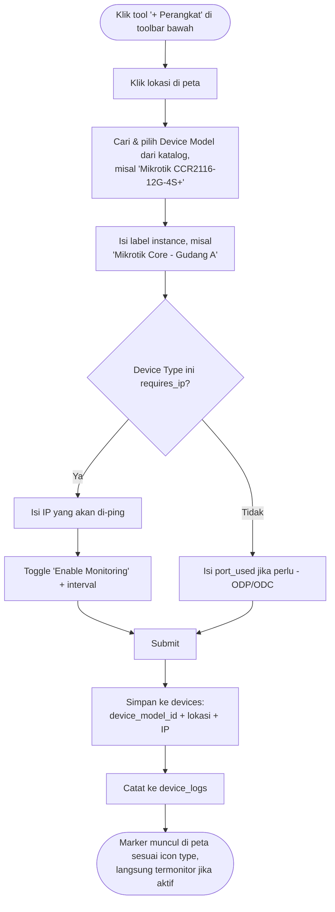

Spek (vendor, port/PON capacity) tidak diketik ulang — otomatis menempel dari `device_models` yang dipilih. Kalau model belum ada di katalog, admin diarahkan ke flow #5 dulu. Setelah submit, tool kembali ke Select.

---

## 7. Flow Tambah & Gambar Kabel di Map (pakai katalog kabel)

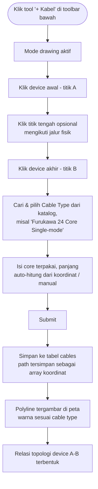

Spek kabel (vendor, core capacity) otomatis menempel dari `cable_types` yang dipilih. Validasi: `core_used` tidak boleh melebihi `core_capacity`.

---

## 8. Flow Monitoring (Ping Otomatis)

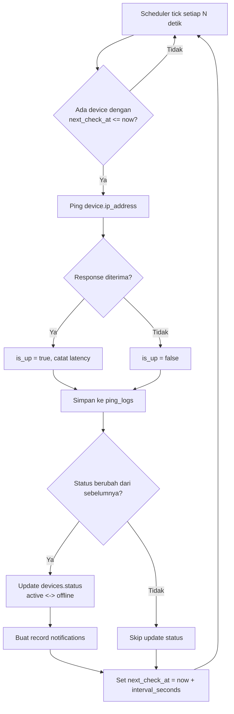

Frontend polling status device secara berkala → marker di peta berubah warna (hijau = up, merah = down, abu = tidak dimonitor) tanpa reload halaman.

---

## 9. Flow Notifikasi (kanan atas)

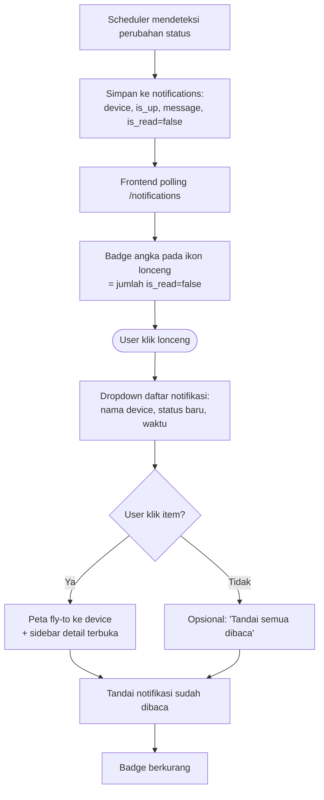

---

## 10. Flow Sidebar Detail Perangkat & Upload Gambar

Sidebar slide-in dari kanan sebagai overlay di atas peta (tidak menggeser layout). Ikon notifikasi di kanan atas tetap terlihat.

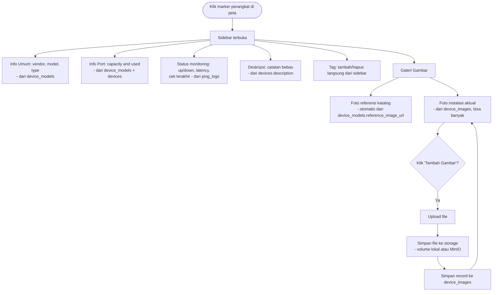

Foto referensi katalog otomatis sama untuk semua instance model yang sama (bantu identifikasi visual); foto instalasi spesifik per lokasi (bantu verifikasi kondisi lapangan).

---

## 11. Fitur Nice-to-Have: Search, Filter by Type, Tag, & Clustering

**Tags** (many-to-many): satu device bisa punya banyak tag (misal "Sidoarjo" + "Backbone" sekaligus).

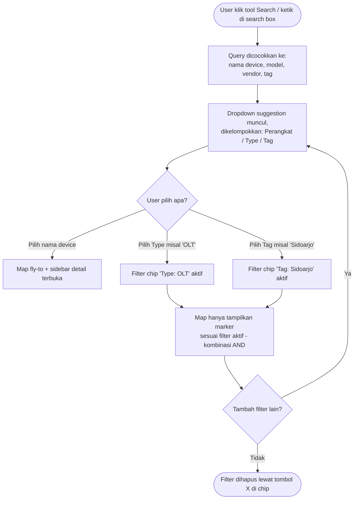

**Clustering toggle:**

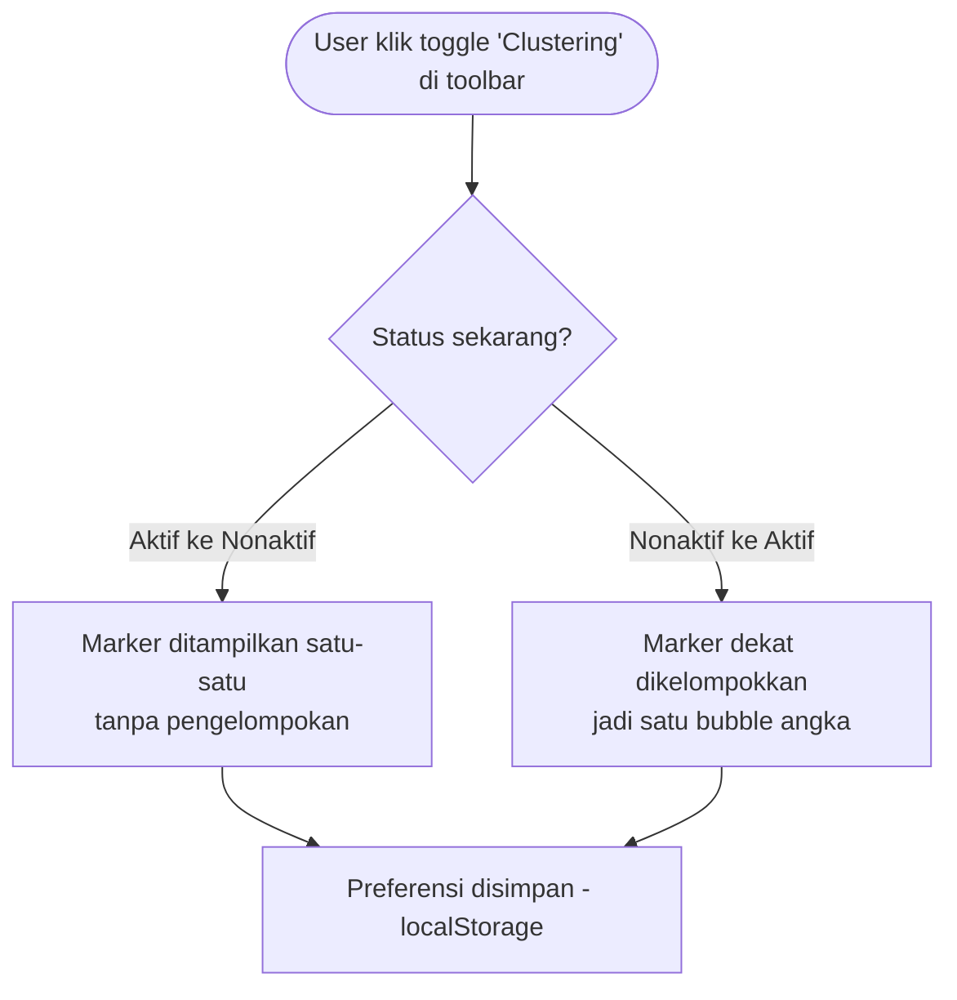

---

## 12. Flow Besar End-to-End (Ringkasan)

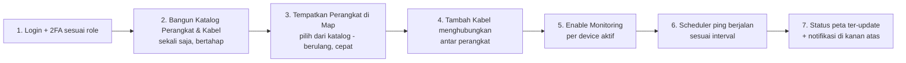

Katalog (langkah 2) dibangun bertahap sesuai kebutuhan — tidak harus lengkap di awal. Begitu model baru ditemukan di lapangan (misal ONU tipe baru), tinggal tambah sekali ke katalog, lalu bisa dipakai untuk semua instance berikutnya.

---

## Catatan Implementasi Penting

- **PostGIS**: aktifkan extension untuk query spasial (cari perangkat terdekat, dsb) jika dibutuhkan ke depan.
- **Ping dari Bun**: tidak ada raw ICMP native — gunakan `child_process.spawn('ping', ...)` atau library `ping`; pastikan binary `ping` ada di image Docker API.
- **Scheduler**: hindari satu `setInterval` per device; gunakan satu loop tick + kolom `next_check_at` per device (ada di `monitoring_config`).
- **2FA**: TOTP via library `otpauth`, QR via `qrcode`, password hashing pakai `Bun.password` (built-in).
- **.env**: semua kredensial & konfigurasi (DB, port, `VITE_API_URL`, batas upload) lewat `.env`, tidak ada hardcode; sertakan `.env.example` di repo.
- **Search**: awal pakai `ILIKE` di Postgres (nama/model/vendor + join tags), upgrade ke `pg_trgm` kalau butuh fuzzy search di skala besar.
- **Clustering**: library `leaflet.markercluster` / `react-leaflet-cluster`, toggle state disimpan di localStorage.
- **Tag**: input bebas, auto-create kalau belum ada, bisa ditambah langsung dari sidebar device.
- **UI overlay**: container overlay `pointer-events: none`, panel `pointer-events: auto`; nonaktifkan kontrol zoom bawaan Leaflet.
- **Retensi `ping_logs`**: perlu kebijakan hapus data lama agar tabel tidak membengkak.
- **Belum diputuskan**: enkripsi `two_fa_secret`, mekanisme recovery/backup codes, JWT vs session DB, granularity permission per role, status baca notifikasi per user atau global.
